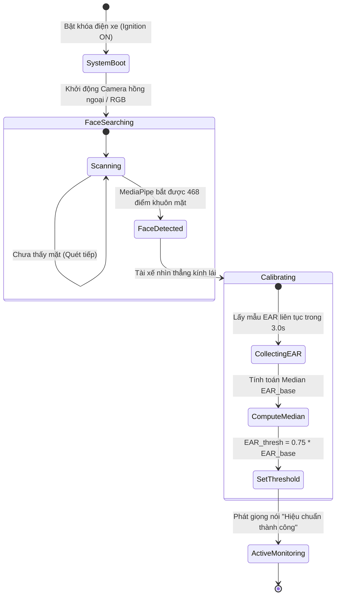
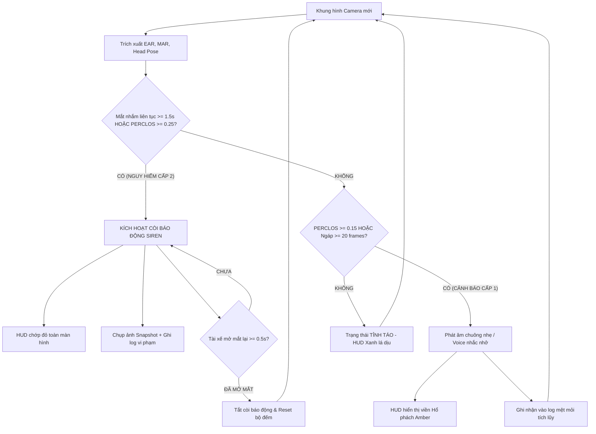
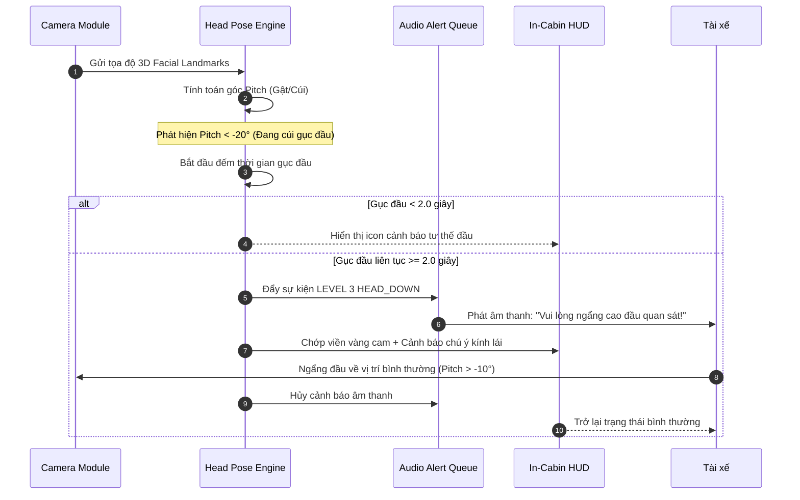
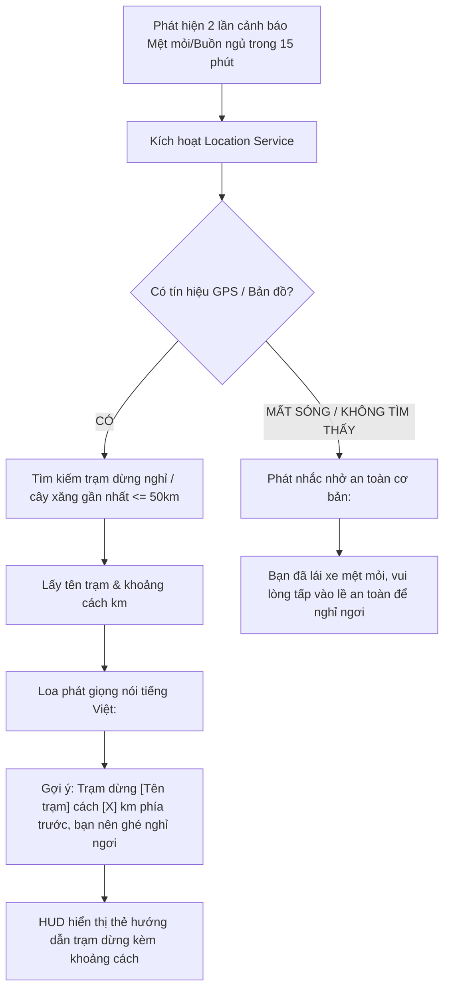
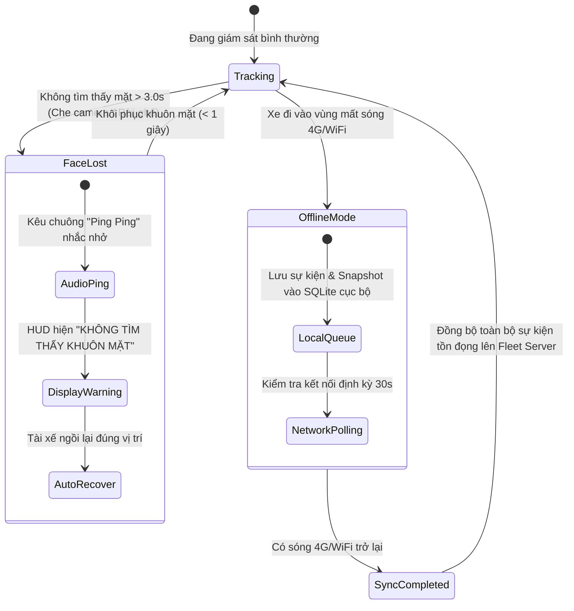

# SleepAlert User Flows & Interaction State Specification

> **Provenance**
> - **Source prompt:** [P4.1 — Create User Flows](../prompts/create-user-flow.prompt.md)
> - **Artifact status:** `Accepted reviewed sample`
> - **Human action:** Approved primary flows, alert escalation transitions, and fail-safe recovery paths.
> - **Reproduction note:** Maps requirements from Chapter 3 into observable interactive user journeys.

---

## 1. Overview of System Actors & Environments

SleepAlert operates across two distinct user environments:
1. **In-Cabin Driver Environment (Primary Real-time Actor):** Completely hands-free, glance-based visual feedback ($\le 1$ second glance), with primary reliance on acoustic warnings.
2. **Central Fleet Safety Management Environment (Secondary Administrative Actor):** Desktop/tablet browser interface, managing real-time vehicle fleets, monitoring incident logs, and triaging safety violations.

---

## 2. Core User Flows

### Flow 1: Khởi động Xe & Tự động Hiệu chuẩn Mắt (Ignition & 3-Second Calibration)

* **Step-by-step Execution:**
  1. Xe nổ máy, thiết bị Edge tự động khởi động dịch vụ trong vòng 5 giây.
  2. Camera hiển thị khung ngắm khuôn mặt trên HUD với trạng thái `ĐANG TÌM KHUÔN MẶT` (Vàng nhạt).
  3. Khi tài xế ngồi vào ghế lái và nhìn về phía trước, hệ thống kích hoạt thanh tiến trình hiệu chuẩn 3.0 giây.
  4. Hệ thống thu thập chuỗi giá trị EAR, loại bỏ nhiễu ngoại lai, xác định ngưỡng mắt mở tự nhiên của riêng tài xế đó ($EAR_{base}$).
  5. Ngưỡng cảnh báo nhắm mắt $EAR_{thresh}$ được chốt tại $75\%$ của $EAR_{base}$. Loa phát âm báo ngắn xác nhận hệ thống sẵn sàng bảo vệ.

---

### Flow 2: Giám sát Trạng thái & Thang Cảnh báo Đa tầng (Continuous Monitoring & Multi-Stage Alert)

* **Quy tắc chuyển trạng thái:**
  * **Xanh lá (Normal):** Tài xế tỉnh táo, mắt mở bình thường, HUD hiển thị thông số gọn gàng không gây phân tâm.
  * **Hổ phách (Level 1 Warning):** Phát hiện ngáp liên tục hoặc mệt mỏi tích lũy $\rightarrow$ Nhắc nhở âm thanh dịu để tài xế chủ động điều chỉnh.
  * **Đỏ nhấp nháy (Level 2 Critical Siren):** Mắt nhắm $\ge 1.5$s (Microsleep) $\rightarrow$ Còi hú cường độ lớn tức thì $< 500$ms, còi chỉ tắt khi tài xế mở mắt dứt khoát.

---

### Flow 3: Cảnh báo Gục đầu & Mất tập trung (Head Down & Distraction Flow)

---

### Flow 4: Gợi ý Trạm dừng chân Thông minh (Location-aware Rest Stop)

---

### Flow 5: Xử lý Sự cố & Hoạt động Ngoại tuyến (Fail-Safe & Offline Recovery Flow)

